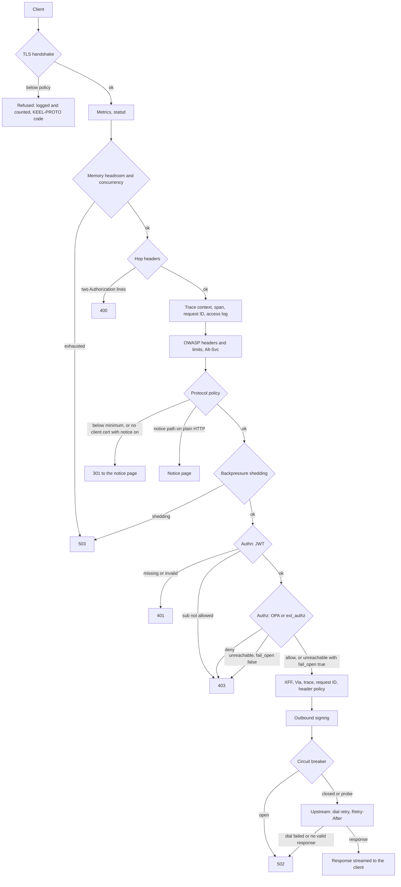
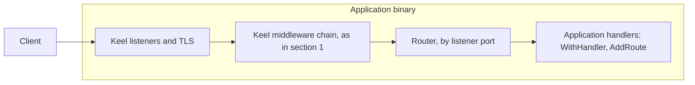
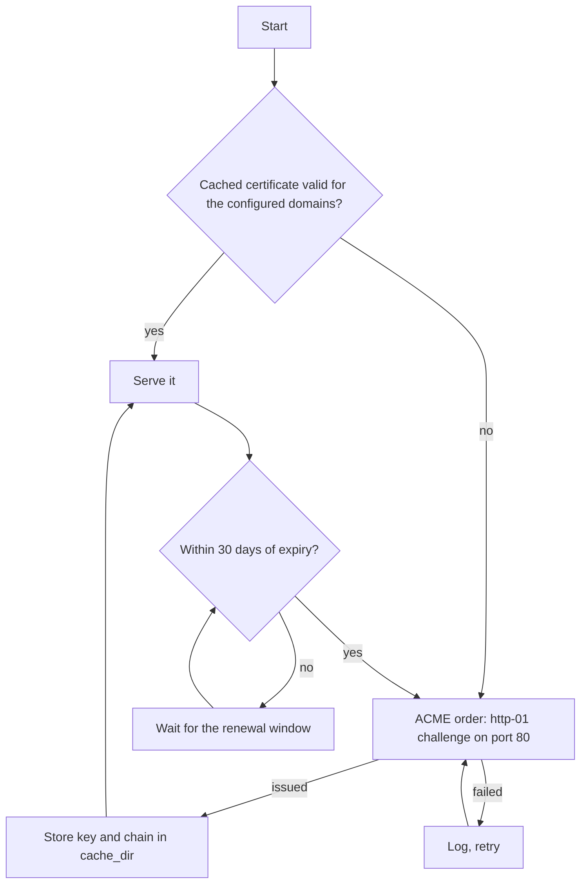
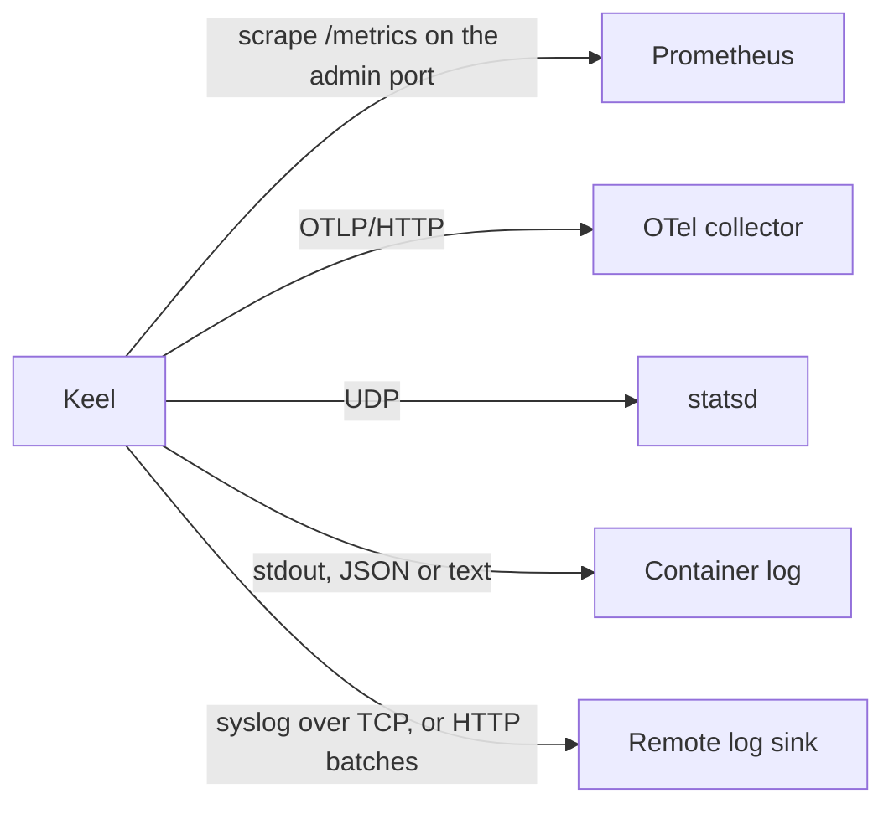
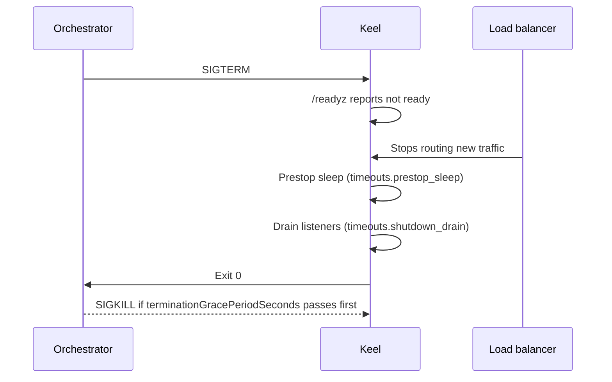

# Architecture

How a request, a certificate, a telemetry signal and a shutdown move through Keel. Policy details live in
[security.md](security.md) and [operations.md](operations.md).

## 1. North/South Request (Sidecar)

Every step runs in this order for HTTP, HTTPS and HTTP/3 listeners (`Server.wrapMain` in `pkg/core/server.go`). Health,
readiness, startup and admin listeners have their own muxes and skip this chain.

When a JWKS endpoint is unreachable, Keel keeps serving the last good keys until the failure backoff ends; with no
good keys, the token fails with 401. An expired certificate is served until it is replaced: ACME renews before expiry,
and `keel_tls_cert_expiry_seconds` alerts first.

## 2. Library Mode

The same chain, inside the application's binary. The application registers handlers instead of proxying.

## 3. Certificate Lifecycle

Certificates from files take the same path to the listeners through `CertLoader`; SIGHUP reloads them.

## 4. Observability Fan-Out

Outbound HTTP and TLS use one policy (`pkg/core/tlspolicy`). The remote sink and the OTLP exporter buffer without
blocking requests, and count what they drop.

## 5. Shutdown

Keep `terminationGracePeriodSeconds` above `prestop_sleep` plus `shutdown_drain`, so the drain finishes before SIGKILL.
